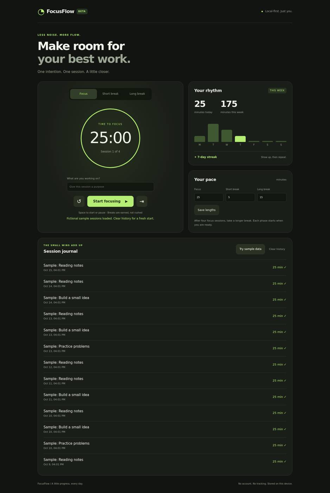

# FocusFlow

### Less noise. More flow.
A quiet, local-first Pomodoro timer. Set an intention, give it your attention, and watch the small wins add up.

## Preview



## What it does
- Focus, short-break and long-break modes with editable lengths.
- A longer break after every four completed focus sessions.
- Start, pause, reset and skip, plus a spacebar shortcut outside form controls.
- Session journal, today's minutes, Monday-to-Sunday weekly chart and daily streak.
- Browser-local persistence for lengths, intention and completed sessions.
- Optional, clearly labeled fictional sample sessions. New installs begin empty.
- Responsive layout, visible keyboard focus and reduced-motion support.

## Run it
Open `index.html` in a modern browser. No build, install, account, framework, external font or API key is needed. For a local server:

```sh
python3 -m http.server 8000
```

## How time works
The timer compares a target timestamp with the current clock rather than subtracting a second on every callback. This avoids accumulating interval drift when a tab is inactive. Only completed focus sessions add minutes. Pausing, resetting or skipping does not log a session. Each new phase waits for you to start it.

The streak counts consecutive local-calendar days with completed sessions. An unfinished current day does not break yesterday's streak. Weekly totals use the local Monday-to-Sunday week.

## Tests
```sh
node tests.js
```
Eight dependency-free logic tests cover phase transitions, clock rounding, Monday-based totals, empty history, local date keys and streak continuity. Browser checks also exercise ticking, pause, settings, reload persistence and 390px / 320px overflow. The preview is a real browser capture with fictional sample data, not mockups.

## Files
- `index.html` - semantic single-page UI
- `style.css` - responsive botanical dark theme
- `logic.js` - pure date, summary and timer helpers
- `app.js` - UI events, timer lifecycle and local persistence
- `tests.js` - Node assertion tests
- `8-preview.jpg` - real desktop screenshot

## Privacy and limitations
No analytics, network calls or sign-in. Data stays in this browser's local storage and is not synchronized across devices. Clearing site data clears the journal. Reloading resets the active timer, but keeps completed sessions and settings. The browser must stay open for a session to be recorded. This is a focus aid, not an alarm service: suspended devices may delay callbacks. There are no background notifications or audio alerts. Clock changes can affect an active timer. History shows the 30 most recent sessions; totals include all stored sessions.

## Deployment
Static hosting works directly from the repository root. GitHub Pages uses `main` and `/ (root)`.

Built with plain HTML, CSS and JavaScript.
